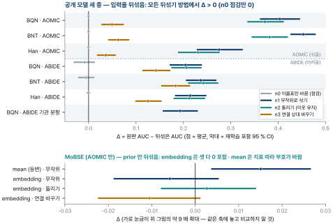
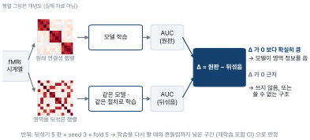
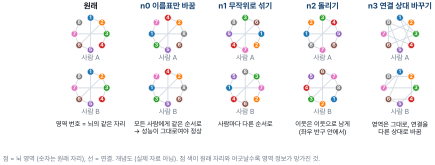
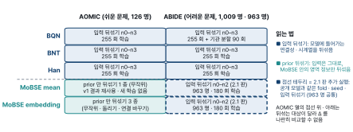
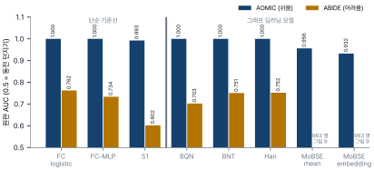
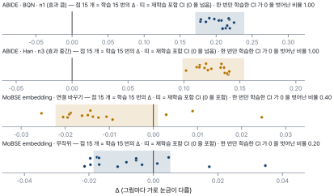
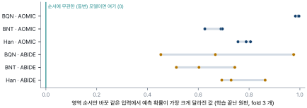
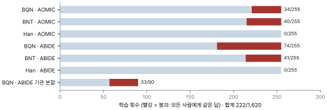

# I1 내부 보고서 — 뇌 그래프 모델은 정말 "뇌 영역 정보"를 쓰는가

| 항목 | 내용 |
|---|---|
| 과제명 | MoBSE (Mixture of Brain-State Experts) — I1 뇌 그래프 prior 검증 프로토콜 |
| 보고 성격 | 내부 보고서 (BMC 보고서 작성 규정 §2) — 분량 제한 없음, 근거 · 기각된 대안까지 남김 |
| 연구책임자 | Dr. Hwon Heo |
| 보고일자 · 판 | 2026-10-13 · 2.0 |
| 발행 주체 | 서울아산병원 아산생명과학연구원 융합연구지원센터 바이오메디컬컴퓨팅코어 |
| | Biomedical Computing Core, Convergence Research Support Center, Asan Institute for Life Sciences, Asan Medical Center |

---

## 핵심 요약

> [!key] **한 줄 결론**
> 공개 뇌 그래프 모델 세 종 (BQN · BNT · Han) 은 뇌 영역을 뒤섞으면 성능이 분명히 떨어짐 — **어떤 방법으로 뒤섞어도 결론은 같았음.** 따라서 "뒤섞는 방법에 따라 결론이 달라진다" 는 이 연구의 중심 예상 (C2) 은 이번 자료에서 맞지 않았음.

> [!warn] **이 보고서는 MoBSE 와 공개 모델의 성능 대결이 아님**
> - 시험 대상은 모델이 아니라 **"영역을 뒤섞어 보는 검증 방법"** 자체임.
> - MoBSE 는 쉬운 자료 (AOMIC) 에서만, 다른 방식 (입력이 아닌 prior 만 뒤섞기) 으로 돌았음 — 공개 모델과 같은 줄에 놓고 비교할 수 없음 (2 장).
> - 수치 판정은 다중비교 보정이 없어 **모두 탐색적**임.

### 질문별 답

| 질문 | 답 | 그림 |
|---|---|---|
| 공개 모델은 영역 정보를 쓰나 | **씀** — 점검용 n0 를 뺀 세 뒤섞기에서 두 자료 · 세 모델 모두 성능이 떨어짐 | 그림 1 |
| 뒤섞는 방법이 결론을 바꾸나 (C2) | **아니오** — 떨어지는 크기만 다름 (연결 바꾸기 n3 이 가장 작음) | 그림 1 |
| 한 번만 학습한 결과를 믿어도 되나 (C3) | 효과가 클 때는 결론이 같음. 효과가 작을 때 (MoBSE embedding) 는 "유의" 착시가 생김 | 그림 6 |
| 쉬운 자료로 모델을 가를 수 있나 (C4) | **아니오** — AOMIC 은 단순 기준선도 거의 만점. 다만 뒤섞기 판정은 쉬운 · 어려운 자료에서 같았음 | 그림 5 |
| 순서에 무관한 (등변) 모델은 뒤섞어도 같나 (C1) | 이론으로는 그러함. 실측은 MoBSE mean 하나뿐이고 지표에 따라 부호가 바뀌어 확인했다고 할 수 없음 | 그림 1 아래 |
| 공개 코드는 그대로 재현되나 (C5) | **아니오** — 네 저장소의 분할 · seed · 평가 규칙이 모두 달랐음. 학습 붕괴 222/1,620 | 그림 8 |



### 그래서 무엇을 뜻하나

- 공개 모델 셋에 대해 "영역 정보를 쓴다" 는 판정은 이번 자료에서 **뒤섞는 방법을 바꿔도 흔들리지 않았음.**
- 이 연구가 찾으려던 "검증 방법의 허점" 은 좁게만 드러남.
  - 효과가 작을 때 한 번만 학습한 결과가 "유의" 를 내는 착시 (5 장).
  - 등변 모델에서 이론과 실측이 맞는지 확인하지 못함 (그림 1 아래).
- MoBSE 에 대해 말할 수 있는 것은 좁음 — AOMIC 에서 embedding 은 prior 를 뒤섞어도 성능이 변하지 않았음. 그 뜻은 2 장의 "말할 수 없는 것" 과 함께 읽을 것.

<!-- pagebreak -->

## 1. 무엇을 시험했나

- fMRI 로 잰 뇌 신호를 그래프 (영역 = 점, 영역 사이 연결 = 선) 로 바꿔 학습하는 딥러닝 모델이 많음.
- 이런 모델이 잘 맞히면 흔히 "모델이 **어느 영역인지 · 어디에 있는지**를 활용한다" 고 해석함.
- 이 해석을 확인하는 표준 방법이 **뒤섞기 시험**임 (그림 2) — 영역을 뒤섞은 가짜 자료로 다시 학습해 성능이 떨어지는지 봄.
- I1 은 이 시험 자체가 믿을 만한지를 물음.
  - 모델 구조 · 뒤섞는 방법 · 학습을 다시 할 때의 흔들림 · 문제의 난이도에 따라 결론이 바뀌는지 잼.





> **꼭 알아야 할 용어 다섯**
> - **AUC**: 맞히는 능력. 0.5 = 동전 던지기, 1.0 = 완벽.
> - **Δ (델타)**: 원래 AUC − 뒤섞은 AUC. 0 보다 확실히 크면 모델이 영역 정보를 씀.
> - **재학습 포함 CI**: 학습을 여러 번 다시 해서 생기는 흔들림까지 넣은 범위. 이 범위가 0 을 넘으면 "0 보다 큼" 으로 읽음.
> - **등변 (순서에 무관)**: 영역 순서를 바꿔도 출력이 같은 구조. 이런 모델은 뒤섞어도 성능이 원리적으로 같아야 함.
> - **붕괴**: 학습이 망가져 모든 사람에게 같은 답을 내는 경우.
> - 전체 용어 풀이는 첨부 E, 자료 · 모델 · 절차 상세는 첨부 F.

### 미리 세운 주장 다섯

| # | 원래 주장 (요지) |
|---|---|
| C1 | 영역 순서에 무관한 구조 (등변 구성) 에서는 원래 그래프와 뒤섞은 그래프가 원리적으로 같은 모델임 |
| C2 | "영역 대응을 쓰는가" 의 판정은 뒤섞는 방법 (null 종류) 에 따라 달라짐 |
| C3 | 한 번 학습한 결과의 CI 는 재학습 흔들림을 빠뜨려, 효과가 없어도 "유의" 를 자주 냄 |
| C4 | 너무 쉬운 문제 (포화) 에서는 구조 비교가 정보를 잃음 — 단순 기준선이 이를 미리 보여 줌 |
| C5 | 공개 구현을 그대로 돌리는 데 드는 수정 · 실패를 기록함 |

## 2. 무엇과 무엇을 비교하나

> [!warn] **비교의 단위는 "모델 대 모델" 이 아니라 "모델 대 뒤섞은 자기 자신" 임**
> 각 모델의 Δ 는 그 모델을 원래 자료와 뒤섞은 자료로 학습해 얻은 차이임. 모델끼리 나란히 볼 수 있는 것은 **같은 자료 · 같은 뒤섞기**에서 "Δ 가 0 을 넘는가" 라는 판정뿐임.



### MoBSE 를 공개 모델과 나란히 놓을 수 없는 이유

| 항목 | 공개 모델 (BQN · BNT · Han) | MoBSE (mean · embedding) | 그래서 |
|---|---|---|---|
| 자료 | AOMIC · ABIDE | AOMIC 만 | 어려운 문제 (ABIDE) 에서 비교 불가 |
| 뒤섞는 대상 | 모델에 들어가는 입력 (연결성 · 시계열) | 입력은 그대로, 모델 안의 영역 정보 (prior) 만 | 서로 다른 개입 — Δ 크기를 나란히 놓으면 안 됨 |
| 뒤섞기 종류 | n0 · n1 · n2 · n3 | mean: 무작위 1 종 (v1 결과 재사용) · embedding: 무작위 · 돌리기 · 연결 바꾸기 | 점검용 n0 이 MoBSE 에 없음 |
| 학습 규칙 | 저장소 기본 설정 · 튜닝 없음 | v1 · v3 잠금이 정한 학습 규칙 | 같은 조건의 학습이 아님 |
| AOMIC 원판 AUC | 세 모델 모두 천장 (4 장 표) | mean · embedding 이 천장보다 낮음 (4 장 표) | 원판 성능 차이도 천장 효과와 섞임 |

### 말할 수 있는 것과 없는 것

| 말할 수 있음 | 말할 수 없음 |
|---|---|
| 공개 모델 각각이 자기 입력 뒤섞기에 반응함 (Δ > 0) | MoBSE 가 공개 모델보다 영역 정보를 덜 (또는 더) 씀 |
| 같은 자료 · 같은 뒤섞기에서 공개 모델 셋의 판정이 같음 | 어느 모델이 더 좋은가 (성능 우열) |
| AOMIC 에서 MoBSE embedding 은 prior 를 뒤섞어도 성능이 변하지 않음 (세 방법 모두 0 포함) | ABIDE 에서 MoBSE 가 어떻게 행동하는가 (돌리지 않음) |
| MoBSE mean 의 Δ 는 지표에 따라 부호가 바뀜 — 등변 이론을 실측으로 확인하지 못함 | MoBSE 의 Δ ≈ 0 이 "영역 정보를 쓰지 않는다" 는 뜻인지, "prior 만 뒤섞는 개입이 약하다" 는 뜻인지 |

### 나란히 비교하려면 필요한 것 (제안 — 정하지 않음)

1. MoBSE 를 ABIDE 에서 공개 모델과 같은 fold · seed · **입력 뒤섞기 n0–n3** 로 돌림 — 가장 직접적인 비교임.
   - MoBSE 를 ABIDE 에 맞추는 작업 (template bank 를 어느 자료로 만들지 등) 이 먼저 필요함 — 범위는 확인하지 않음.
   - 결과를 본 뒤의 설계 변경이므로 새 잠금판이 필요함 (잠금 §10).
2. 반대로 공개 모델에도 "입력은 그대로, 모델 안의 영역 정보만" 뒤섞는 대조를 둠 — 모델마다 그런 자리가 있는지부터 정의해야 함.
3. AOMIC 대신 천장이 아닌 문제를 둠 — 원판 성능 비교가 가능해짐.
- 셋 다 새 실행이며 선생님 판단 사항임 (13 장).

## 3. 결과 Ⅰ — 영역을 뒤섞으면 성능이 얼마나 떨어지나

- 그림 1 (핵심 요약) 의 수치임.
- 표의 값은 Δ = 원판 AUC − 뒤섞은 AUC, 괄호는 재학습 포함 95 % CI임 (모두 탐색적).
- n0 은 점검용이라 0 근처여야 정상임.

| 모델 | 자료 | n0 (점검) | n1 (무작위 섞기) | n2 (돌리기) | n3 (연결 바꾸기) | 함께 읽을 것 (교락) |
|---|---|---|---|---|---|---|
| BQN | AOMIC | +0.0000 [−0.0001, +0.0003] | +0.4034 [+0.3614, +0.4463] | +0.3721 [+0.3347, +0.4120] | +0.0495 [+0.0271, +0.0745] | 천장 자료 · 붕괴 34/255 |
| | ABIDE | −0.0087 [−0.0316, +0.0133] | +0.2045 [+0.1711, +0.2390] | +0.2066 [+0.1746, +0.2383] | +0.1418 [+0.1133, +0.1727] | 붕괴 74/255 |
| BNT | AOMIC | +0.0000 [−0.0000, +0.0000] | +0.4531 [+0.4258, +0.4793] | +0.3820 [+0.3439, +0.4207] | +0.0627 [+0.0412, +0.0859] | 천장 자료 · 붕괴 40/255 |
| | ABIDE | −0.0053 [−0.0221, +0.0119] | +0.2366 [+0.2052, +0.2696] | +0.2424 [+0.2098, +0.2738] | +0.1835 [+0.1532, +0.2142] | 붕괴 41/255 |
| Han | AOMIC | +0.0000 [−0.0000, +0.0000] | +0.2755 [+0.2284, +0.3253] | +0.2312 [+0.1887, +0.2765] | +0.0365 [+0.0177, +0.0574] | 천장 자료 · 붕괴 없음 |
| | ABIDE | −0.0003 [−0.0047, +0.0036] | +0.2146 [+0.1822, +0.2486] | +0.2123 [+0.1794, +0.2460] | +0.1255 [+0.0986, +0.1539] | 붕괴 없음 · OOM 재실행 149 회 (결정 50) |
| BQN 기관 분할 | ABIDE | — | +0.1932 [+0.1565, +0.2306] | — | — | 붕괴 33/90 · 뺀 민감도 계산 불가 |

- n3 열 전체의 교락: 연결성 행렬만 바꾸고 시계열은 원래 것을 둠.
  - 세 모델 모두 시계열도 받으므로 두 입력이 서로 어긋남 (잠금 §9) — n3 의 Δ 가 "연결 상대" 만의 효과라고 단정할 수 없음.
- 읽는 법:
  - 점검용 n0 은 모두 0 을 포함함 — 이름표만 바꾼 경우 성능이 그대로임을 확인함.
  - n1 · n2 · n3 은 두 자료 · 세 모델 모두 CI 가 0 을 넘음 — **"영역 정보를 쓴다" 는 판정이 뒤섞는 방법과 무관하게 같음.**
  - 바뀐 것은 크기뿐임. n3 이 가장 작음 (AOMIC 0.04–0.06 · ABIDE 0.13–0.18), n1 · n2 는 0.20–0.45.

### MoBSE (AOMIC, 영역 순서 정보 (prior) 만 뒤섞음)

| 구조 | 무작위 섞기 | 돌리기 | 연결 바꾸기 | 함께 읽을 것 |
|---|---|---|---|---|
| mean (등변) | +0.0151 [+0.0038, +0.0264] | — (v1 에 없음) | — | 같은 예측을 v1 방식 (BA · seed 3 개 평균) 으로 보면 Δ −0.016 또는 0 — 지표에 따라 부호가 바뀜 |
| embedding (순서 의존) | −0.0058 [−0.0186, +0.0052] | +0.0027 [−0.0077, +0.0138] | −0.0106 [−0.0222, +0.0010] | 셋 다 0 을 포함함 |

- MoBSE mean 은 등변 구조라 이론상 Δ 가 0 이어야 함 (C1).
  - I1 방식 (seed 별 AUC) 으로는 0 을 넘고, v1 방식 (BA · seed 평균) 으로는 0 을 포함함.
  - 부호 차이는 지표 (AUC 대 BA) 와 seed 평균 여부 두 갈래에서 옴 (결정 52) — **"같음을 실측으로 확인했다" 고 쓰지 않음.**
- MoBSE embedding 은 세 방법 모두 영역 정보 의존을 보이지 않음.

## 4. 결과 Ⅱ — 원래 성능 (기준선과 원판)



| 자료 | FC logistic | FC-MLP | S1 | BQN | BNT | Han |
|---|---:|---:|---:|---:|---:|---:|
| AOMIC (쉬움) | 1.0000 | 0.9999 | 0.9925 | 1.0000 | 1.0000 | 1.0000 |
| ABIDE (어려움) | 0.7624 | 0.7337 | 0.6022 | 0.7025 | 0.7508 | 0.7521 |

| 그 밖의 원판 | AUC |
|---|---:|
| ABIDE BQN 기관 분할 | 0.6634 |
| AOMIC MoBSE mean | 0.9561 |
| AOMIC MoBSE embedding | 0.9324 |

- AOMIC 은 단순 기준선까지 거의 만점임 — **모델 간 비교가 불가능함** (C4 의 앞부분 성립).
- ABIDE 의 공개 모델 원판 (0.703–0.752) 은 점추정으로 FC logistic (0.762) 보다 낮거나 비슷함.
  - CI 로 비교하지 않았으므로 우열을 주장하지 않음.

## 5. 결과 Ⅲ — 한 번만 학습하면 착시가 생기나 (D3)



- 단일 CI (한 번 학습) 가 0 을 벗어난 비율을 셈. 재학습 포함 CI 와 결론이 같은지 봄.

| 대상 | n0 | n1 · n2 · n3 | 재학습 포함 CI 와 결론 |
|---|---|---|---|
| 공개 모델 셋 · 두 자료 | 0/3 짝 | 15/15 짝 | 같음 |
| BQN 기관 분할 (ABIDE, n1) | — | 15/15 | 같음 |
| MoBSE mean (무작위 섞기) | — | 0.27 | 같음 (둘 다 0 을 넘음) |
| MoBSE embedding | — | 무작위 섞기 0.20 · 돌리기 0.07 · 연결 바꾸기 0.40 | **다름** — 재학습 포함 CI 는 셋 다 0 을 포함 |

- 효과가 큰 곳 (공개 모델) 에서는 한 번 학습해도 결론이 같았음.
- 효과가 작은 곳 (MoBSE embedding) 에서는 한 번 학습한 CI 가 "유의" 를 냄 — **C3 는 이 좁은 범위에서만 관찰됨.**
  - 예: 연결 바꾸기 한 짝 (k0/r42) 의 단일 −0.025 [−0.052, −0.001] 대 재학습 포함 −0.011 [−0.022, +0.001].
- 흔들림의 크기 (ABIDE 공개 모델 n1–n3):

| 항목 | 범위 |
|---|---|
| seed 간 Δ 의 표준편차 | 0.0078–0.0228 |
| 단일 CI 반폭 중앙값 | 0.0307–0.0483 |

## 6. 결과 Ⅳ — 학습이 끝난 모델은 영역 순서에 무관한가 (D1)



- 원판 모델에 영역 순서만 20 가지로 바꾼 같은 입력을 넣고, 예측 확률이 가장 크게 달라진 값을 잼.
  - 0 이면 순서에 무관 (등변), 클수록 순서에 의존함.

| 모델 | AOMIC fold 0 · 1 · 2 | ABIDE fold 0 · 1 · 2 | 학습 전 |
|---|---|---|---|
| BQN | 0.983 · 0.994 · 0.997 | 0.667 · 0.975 · 0.453 | 4.9e−4 (순서 의존) |
| BNT | 0.626 · 0.689 · 0.695 | 0.603 · 0.514 · 0.744 | 1.3e−3 (순서 의존) |
| Han | 0.756 · 0.788 · 0.806 | 0.729 · 0.863 · 0.693 | 재지 않음 (코드상 순서 의존) |

- 같은 입력을 두 번 넣은 차이는 18 개 모두 0 — 측정 자체는 안정함.
- 세 공개 모델은 학습 뒤에도 순서에 강하게 의존함 (0.45–0.997).
- ABIDE 에는 순서에 무관한 공개 모델이 없음 — BrainGB 가 제외됐기 때문임. C1 의 실측 범위가 AOMIC MoBSE mean 하나로 좁아진 이유임.

## 7. 결과 Ⅴ — 학습이 망가진 경우 (붕괴)



| 자료 | BQN | BNT | Han |
|---|---|---|---|
| AOMIC | 34/255 | 40/255 | 0 |
| ABIDE | 74/255 | 41/255 | 0 |
| ABIDE 기관 분할 | 33/90 | — | — |
| 합계 | 222/1,620 | | |

- 판정은 붕괴를 포함한 전체로 함 (잠금 §8). 붕괴를 뺀 결과는 민감도로만 봄 (결정 55-1).
- BQN ABIDE n3 의 상수 붕괴 5 회는 뒤섞은 쪽 AUC 를 낮춰 Δ 를 키우는 방향임.
  - 붕괴를 빼도 +0.134 [+0.099, +0.167] 로 0 을 넘음 — 결론 유지.
- ABIDE BQN n1 · n2 는 붕괴를 빼면 1 짝만 남아 재학습 포함 CI 를 따로 낼 수 없음.
- 기관 분할은 붕괴 없는 단위가 원판 r3 하나뿐이라 **뺀 민감도를 계산할 수 없음** — 이 한계와 함께 읽을 것.
- 붕괴가 **왜** 생겼는지는 재지 않음 — 모양 (어느 기준에 걸렸는지 · 어느 답으로 몰렸는지) 만 진단함.

## 8. 결과 Ⅵ — 공개 코드를 돌리는 어려움 (C5)

| 항목 | 관찰 |
|---|---|
| 저장소 수정 | 파일은 고치지 않고 분할 · 평가 · seed 함수를 메모리에서 바꿔 끼움 (모델당 4–7 항목) |
| 호환 수정 | BNT · Han 은 torch ≥ 2.0 호환 수정 필요 |
| 공통 5-fold | 네 저장소 모두 쓰지 않음 |
| 시험값 고르는 규칙 | 저장소마다 다름 — 검증 손실 최소 · 검증 AUC 최대 · 고르지 않음 · 마지막 epoch |
| seed 고정 | 셋 (BQN · BNT · BrainGB) 은 재현 가능한 seed 를 바꿀 수 없었음 |
| 학습 불가 | BrainGB — 저장소 설정으로 학습되지 않아 제외 (결정 47) |
| 본 실행 | 공개 모델 1,620 회, 최종 실패 0. ABIDE Han 149 회는 GPU 메모리 부족 (OOM) 으로 다시 돌림 (결정 50) |

## 9. 안 된 것 · 음성 결과 (숨기지 않음)

1. **C2 는 지지되지 않음** — 미리 세운 주장 중 가장 중심이던 것임. 뒤섞는 방법은 판정을 바꾸지 않고 크기만 바꿈.
2. C3 는 좁게만 관찰됨 — 효과가 큰 공개 모델에서는 단일 CI 와 재학습 포함 CI 가 늘 같은 결론이었음.
3. C1 의 실측은 한 모델 · 한 자료이고 부호가 지표에 따라 바뀜 — "같음을 실측으로 확인" 이라고 쓰지 않음.
4. **BrainGB (유일한 등변 공개 모델) 는 학습되지 않아 제외함** (결정 47).
   - 원판 5 fold 시험 AUC 0.461–0.529, 학습 AUC 도 0.55 미만. degree z-score 입력으로도 같음 (0.448–0.527). 잠금 전 확인임.
   - 원인 후보 (1 차원 strength 입력 + 평균 pooling · 저장소 학습 루프) 를 가르는 측정은 하지 않음.
5. 붕괴 222/1,620 — 7 장. ABIDE 는 원판에도 붕괴가 있음 (BQN r1/f3 · 기관 분할 3 회, 200 epoch 상수 출력).
6. AOMIC 은 원판 비교에 쓸 수 없었음 — 기준선 · 원판 모두 천장. 양성 대조로만 작동함.
7. 계산된 곳에서는 붕괴를 빼도 판정 문장이 바뀌지 않음. 단 ABIDE BQN n1 · n2 는 1 짝뿐임 (7 장).

## 10. 계획에서 벗어난 것과 운영 사건

| # | 무엇 | 계획 (잠금) 과의 관계 | 결과에 미친 영향 |
|---|---|---|---|
| 1 | **결정 50** — ABIDE Han 의 GPU 메모리 부족 149 회 (재시도까지 실패 79 · 한 번 실패 70) 를 동시 실행 1 개로 다시 돌리고 실패로 세지 않음. 원문 "GPU OOM 이므로 실패로 치지 않음" | **이탈** — 잠금 §8 은 "GPU 메모리 부족도 같은 규칙이다 (다시 돌리지 않고 센다)". 집계 규칙을 ABIDE 결과를 보기 **전에** 바꿈 | Han 255 회 = 동시 2 개 22 회 + 동시 1 개 233 회. 이 처리가 없었으면 완전한 단위가 32/51 (두 번 실패만 뺄 때) 또는 17/51 (전부 뺄 때) — n0 · n1 이 사라짐 |
| 2 | 결정 50-3 · 50-4 — 이 처리를 일반 규칙으로 만들지 않음. GPU 재시도는 GPU 정리 뒤에 함 | 잠긴 구동기는 고치지 않고 작업 실행 함수만 바꿔 끼운 래퍼 사용 (run 폴더, 버전 관리 밖) | 교체 뒤 재시도 0 |
| 3 | 첫 시도 (a1) 중지 — 환경 변수 `PYTHONPATH=.` 때문에 설치 패키지 목록이 달라져 잠금 검증이 막음 | 잠금이 제 역할을 한 사례 (이탈 아님) | 없음 (a1 결과 미사용, 보존) |
| 4 | 잠금 생성 전 `.pyc` 0 확인 누락 (h197 사본 105 개) | 절차 누락 | 없음 (해시는 `.py` 만, 재검증 rc=0) |
| 5 | 결정 49 — ABIDE 를 AOMIC 과 병행 실행 | 운영 방식만 바뀜. 잠금 · 설계 불변 | 없음 |
| 6 | 지시 "ok" 를 "80 개 재실행 승인" 으로 잘못 읽음 → 되물어 정정 | 운영자 해석 오류 | 없음 (재실행이 끝난 fit 0 개에서 중지) |

- 잠금 전에 본 결과 (smoke 원판 fold 0 AUC · MoBSE mean 의 I1 방식 계산 · BrainGB 10 회) 는 잠금 문서 §9 에 적혀 있음. 그 값으로 설계를 바꾸지 않음.
- v1 의 이탈 (결정 27 — PIOP2 외부 검증을 하지 않음) 은 I1 도 그대로 따름.

## 11. 한계

1. **다중비교 보정 없음** — 모델 3 × 조건 4 × 자료 2 의 CI 는 모두 탐색적임.
2. ABIDE 에 순서에 무관한 공개 모델이 없음 — C1 의 실측은 AOMIC MoBSE mean 하나.
3. n3 은 연결성만 바꾸고 시계열은 원래 것 — 두 입력이 어긋남 (3 장 교락 열).
4. CC200 은 좌우 반구를 나눠 만든 영역 지도가 아님 — 반구에 걸친 영역 22 개에서 n2 의 반구 판정이 임의적임.
5. AOMIC 은 30 시점 짧은 창 — 공개 모델이 원래 쓰던 긴 시계열과 다르고, 천장이라 원판 비교가 불가함.
6. MoBSE mean 에는 돌리기 · 연결 바꾸기 대조가 없음 (v1 에 없음, 결정 44).
7. 붕괴가 많음 (ABIDE BQN 74/255 · 기관 분할 33/90) — 전체로 판정하고 진단을 병기함. 기관 분할은 뺀 민감도 계산 불가.
8. 튜닝하지 않음 — 저장소 기본 설정 · 저자 명령. 원판 성능이 저자 보고값과 같은지 대조하지 않음.
9. 학습 시간은 공유 GPU · 동시 실행 아래 값 — 효율 비교에 쓰지 말 것.

## 12. 비용 (h197, RTX 3090 Ti 1 장 · 12 코어, 공유 GPU)

| 항목 | 값 | 시간 환산 [계산] | 출처 |
|---|---|---|---|
| 학습 1 회 (단독 smoke, ABIDE fold 0 · seed 1) | BQN 152 s · BNT 194 s · Han 517 s (BrainGB 728 s) | — | 잠금 문서 §5.1 |
| ABIDE Han 학습 1 회 (본 실행, 동시 1 개) | 508–529 s | — | handoff §11.6 · §11.10 |
| n3 가짜 자료 만들기 (5 판) | AOMIC 12,229 s · ABIDE 44,988 s | 3.4 · 12.5 시간 | `driver_{aomic,abide}.log` |
| AOMIC BQN 255 회 | 30,757 s | 8.5 시간 | `driver_aomic.log` |
| ABIDE BQN 255 회 | 59,588 s | 16.6 시간 | `driver_abide.log` |
| ABIDE Han OOM 재실행 149 회 | 78,891 s | 21.9 시간 | `driver_abide.log` |
| ABIDE 기관 분할 90 회 | 10,856 s | 3.0 시간 | `driver_abide.log` |
| 전체 | 10-05 03:15 → 10-08 22:52 KST | 91.6 시간 | `status.txt` |
| 산출 크기 | 12,456 파일 · 15,558 MB (a1 중지판 199 파일 · 3 MB 별도) | — | Notion Data Asset (10-12 실측) |

## 13. 결론과 남은 판단

- **결론 (탐색적)**:
  - 공개 뇌 그래프 모델 셋이 영역 정보를 쓴다는 판정은 뒤섞는 방법 · 자료 난이도와 무관하게 같았음.
  - 따라서 "뒤섞는 방법을 바꾸면 판정이 달라진다" 는 이 연구의 중심 주장은 이번 자료에서 지지되지 않음.
  - 한 번만 학습한 결과의 착시는 효과가 작을 때만 문제가 됨.
- 이 보고서가 답하지 못하는 것:
  - MoBSE 가 공개 모델과 비교해 영역 정보를 얼마나 쓰는지 (2 장 — 같은 조건으로 돌리지 않음).
  - 붕괴가 왜 생겼는지 · BrainGB 가 왜 학습되지 않았는지 (원인 미측정).
  - 공개 모델의 원판 성능이 저자 보고값과 같은지 (대조 안 함).
- 정하지 않은 것 (선생님 판단 필요):
  - MoBSE 와 공개 모델을 같은 조건으로 비교할지 — 2 장의 제안 1–3 중 무엇을 할지.
  - 결과를 본 뒤의 설계 변경 (잠금 §10 — 새 잠금판 필요).
  - PIOP2 개방, I3 (TR 단위 상태 routing) 착수.

## 첨부 A. C1–C5 확정 문장 원문 (결정 55 · 56)

- 본문의 쉬운 말 요약은 아래 원문보다 넓게 읽지 말 것. 출처 `docs/experiments/i1_final_statements_draft_2026-10-12.md` §1.

| # | 확정 문장 |
|---|---|
| C1 | "C1 은 정리로 성립하고, 실측 대조는 MoBSE mean (AOMIC) 하나뿐이다. 그 대조에서 Δ 의 부호는 지표 · 집계에 따라 달라진다 — v1 방식 (seed 앙상블 · BA 0.5) 으로는 Δ −0.016 또는 0 (CI 0 포함, null seed 다섯), I1 방식 (seed 별 AUC 15 짝) 으로는 +0.0151 [+0.0038, +0.0264]. 따라서 '실측으로 같음을 확인했다' 고 쓰지 않는다. ABIDE 에는 등변 공개 모델이 없어 (D1 학습판 최대 차 0.45–0.997) C1 의 실측 범위는 AOMIC 의 한 모델이다." |
| C2 | "C2 는 이번 자료에서 지지되지 않았다 — 판정은 null 종류에 따라 바뀌지 않았다. 공개 모델은 두 자료 · 세 모델 모두 n1 · n2 · n3 에서 재학습 포함 CI 가 0 을 넘고, MoBSE embedding (AOMIC) 은 순열 · spin · rewire 모두 0 을 포함한다. 바뀐 것은 Δ 의 크기다 (n3 이 가장 작다: AOMIC 0.04–0.06 · ABIDE 0.13–0.18, n1 · n2 는 0.20–0.45). n3 은 FC–시계열 불일치가 있다 (잠금 §9)." |
| C3 | "C3 는 효과가 작은 곳에서만 관찰됐다. 효과가 큰 곳 (공개 모델 n1–n3) 에서는 단일 CI 가 짝 15/15 모두 0 을 벗어나고 재학습 포함 CI 와 결론이 같다. 대조 n0 (짝 3) 에서는 두 자료 · 세 모델 모두 단일 CI 가 0 을 벗어난 짝이 없다. 효과가 작은 MoBSE embedding (AOMIC) 에서는 재학습 포함 CI 가 0 을 포함하는데 단일 CI 가 0 을 벗어난 짝이 0.07 (spin) · 0.20 (순열) · 0.40 (rewire) 이었다 (k0/r42 의 rewire 단일 −0.025 [−0.052, −0.001] 대 재학습 포함 −0.011 [−0.022, +0.001])." |
| C4 | "AOMIC 에서는 기준선 (FC logistic 1.000 · FC-MLP 0.9999 · S1 0.9925) 과 공개 모델 원판 (세 모델 1.000) 이 모두 천장이라 원판 성능으로는 모델 · 구조를 가를 수 없었다 — 기준선이 이를 미리 보여 줬다. 그러나 null Δ 의 판정은 포화 (AOMIC) · 비포화 (ABIDE) 자료에서 같았다 — 포화가 null 판정을 바꾸지는 않았다. ABIDE 에서 공개 모델 원판 (0.703–0.752) 은 점추정으로 FC logistic (0.762) 보다 낮거나 비슷하다 (CI 비교 없음 — 우열 주장 없음)." |
| C5 | "세 공개 모델 (BQN · BNT · Han) 은 저장소 파일을 고치지 않고 분할 · 평가 · seed 함수를 메모리에서 바꿔 끼워 돌렸다 (모델당 4–7 항목, BNT · Han 은 torch ≥ 2.0 호환 수정 포함). 네 저장소 모두 공통 5-fold 를 쓰지 않았고, test 값을 고르는 규칙이 서로 달랐으며 (val loss 최소 · val AUC 최대 · 고르지 않음 · 마지막 epoch), 셋 (BQN · BNT · BrainGB) 은 재현 가능한 seed 를 바꿀 수 없었다. BrainGB 는 저장소 설정에서 학습되지 않아 제외했다 (결정 47). 본 실행 공개 모델 1,620 fit 의 최종 프로세스 실패는 0 이나, ABIDE Han 149 fit 은 실행기 동시성이 만든 GPU OOM 으로 k=1 에서 다시 돌렸고 (실패로 세지 않음, 결정 50), 붕괴 fit 은 222 (BQN 141 · BNT 81 · Han 0) 이다." |
| 붕괴 표기 | "ABIDE 판정은 전체 단위로 한다 (잠금 §8). 붕괴 fit BQN 74/255 · BNT 41/255 · site 33/90 · Han 0. … BQN n3 의 상수 붕괴 5 fit 은 null AUC 를 낮춘다 (Δ 를 키우는 방향) — 뺀 민감도는 +0.134 [+0.099, +0.167] 로 0 을 넘는다. site 는 뺀 민감도를 계산할 수 없다 — 이 한계와 함께 읽는다." (전문은 최종 문장 문서 §1) |

## 첨부 B. 산출물 목록 · 잠금

| 항목 | 값 |
|---|---|
| I1 잠금 | `results/i1/locks/i1_lock.json` — lock_hash `ac3bad06f6ef` · code_hash `a5738888b83c` · data_hash `b50b69aa8c4c` · v1 묶음 `08385bf94c3f` |
| 잠금 문서 | `docs/experiments/i1_lock_v1.md` (sha `e418cbf78562`) |
| 함께 쓴 잠금 | v1 측정 `9b7b11cf8576` (MoBSE mean) · v3 `c0c8ed77db50` (MoBSE embedding) |
| 실행 상태 | 전 단계 rc=0 · `fails_*.json` 전부 빈 목록 · ABIDE `logs/` 1,702 개에 Traceback · OOM 0 (k=2 OOM 로그는 `han_oom_k2_20261007/` 에 따로) · `incomplete_units` 전부 0 |

| 분석 산출 (run 폴더 `analysis/`) | sha256 앞 12 자 |
|---|---|
| `aomic/bqn.json` · `bnt.json` · `han.json` | `28b175dce707` · `374944e55ec0` · `89a07cf9c85e` |
| `aomic/mobse_mean.json` · `mobse_embedding.json` | `15cb501a8925` · `6cef00596fea` |
| `aomic/fc_logistic.json` · `fc_mlp.json` · `s1_logistic.json` | `715a440d66ad` · `290cfc3c7923` · `de4a051690d9` |
| `abide/bqn.json` · `bnt.json` · `han.json` | `993c1e990e87` · `79d130c26bfd` · `ecd9ee51b747` |
| `abide/fc_logistic.json` · `fc_mlp.json` · `s1_logistic.json` | `af82d07fe32e` · `883d12adaea3` · `f06187567f8c` |
| `abide_site/bqn.json` | `4fa4f5ca95f8` |

| 진단 (새 학습 없음, run 폴더 `diag/`) | 스크립트 → 결과 sha256 |
|---|---|
| `mobse_mean_20261007/` | `bda494c7515e` → `cbe742aa636b` |
| `collapse_20261012/` | `b9e84ab9c810` → `628d470f5b02` |

## 첨부 C. 재현 방법 (실제로 돈 진입점)

- h197, 저장소 사본 루트, venv-i1. `<D>` = data root, `<R>` = `<D>/i1/main/20261005_ac3bad06_a2`.

```bash
# 잠금 검증 (구동기도 맨 앞에서 같은 검증을 하고, 실패하면 아무것도 시작하지 않음)
python scripts/i1/build_lock.py --verify --repo-root . --data-root <D> --doc docs/experiments/i1_lock_v1.md --out results/i1/locks/i1_lock.json
# 단계 (dataset = abide | aomic; site 는 abide 만). PYTHONPATH 를 내보내지 말 것 (a1 중지 원인) — MoBSE 팔 명령에만 붙임
python scripts/i1/run_main.py --data-root <D> --out <R> --dataset <dataset> --phase {nulls|fits|site|baselines|analyze} \
    --lock results/i1/locks/i1_lock.json --doc docs/experiments/i1_lock_v1.md [--models bqn bnt han] [--k 2]
# MoBSE 팔 (AOMIC 만, venv-mobse-v2 · v3 잠금 환경)
PYTHONPATH=. python scripts/i1/mobse_arm.py {collect-mean|plan-embedding|run-embedding|collect-embedding} …
# 분석 (구동기 analyze 단계가 모델마다 부름)
python scripts/i1/analyze.py --root <dataset root> --model <model> --out <json> [--n-boot 2000]
# 그림 8 개 (분석 산출 sha 를 보고서 값과 대조한 뒤에만 그림)
.venv/bin/python scripts/reports/make_i1_figures.py --run-root <R> --out results/i1/reports/figs
# 이 보고서의 HTML · PDF 생성 (Mac, 저장소 venv 를 건드리지 않는 일회용 환경)
uv run --no-project --with playwright==1.63.0 python scripts/reports/build_bmc_report.py results/i1/reports/i1_report_2026-10-13.md --pdf
# 이 보고서의 인용 대조
python scripts/h197/30_verify_i1_report_citations.py --data-root <D> --doc results/i1/reports/i1_report_2026-10-13.md
```

- 실제 실행은 run 폴더의 사슬 스크립트 (`orchestrate.sh` · `switch.sh` · `chain_*.sh` · `gpu_clean_retry.py` · `run_*_gc.py`) 가 위 진입점을 부름.
  - 저장소 밖에 둠 — `scripts/i1` 에 두면 잠금이 바뀜. h197 run 폴더에 보존됨.
- 공개 모델 저장소는 commit 고정 clone 을 쓰고 파일을 고치지 않음 (잠금이 clone 의 `git status` 를 확인). 바꿔 끼운 함수는 fit 마다 `summary.json` `patches` 에 남음.
- 대조 스크립트는 `scripts/h197/` 에 둠 — `scripts/i1/` 에 두면 I1 잠금의 code_hash 가 바뀜.

## 첨부 D. 인용 대조 결과

- 대조 스크립트가 산출물에서 값을 다시 읽어 이 문서와 같은 형식으로 만들고, 그 문자열이 문서에 있는지 확인함.
- 대조 범위:

| 대상 | 내용 |
|---|---|
| 분석 산출 15 개 · 진단 2 개 | sha256 앞 12 자 |
| 원판 · 기준선 | AUC (4 자리) · ABIDE 범위 |
| Δ · 재학습 포함 CI | 공개 모델 24 칸 · 기관 분할 · MoBSE 4 칸 · 붕괴 뺀 민감도 |
| D3 | 짝 수 · 비율 · seed 간 SD 범위 · 단일 CI 반폭 범위 |
| 붕괴 | 모델별 수 · 합계, 분석 산출과 진단 산출의 일치 |
| D1 | 18 개 최대 차 · 같은 입력 차 0 |
| 비용 | `status.txt` 벽시계 · driver 로그 경과 6 개 |

- 대조하지 않는 값: 잠금 해시 · 잠금 전 측정 (BrainGB · smoke 시간) · 산출 크기 · 결정 50 의 단위 수 — 위 산출물에 없는 값임.
- 결과 (2026-10-13, h197): 대조 항목 183 · **불일치 0** (rc=0).
  - 돌연변이 확인: 값 하나를 바꾼 사본 5 개 (Δ · 붕괴 수 · 벽시계 · D1 · sha) 모두 불일치 1 로 잡힘.
  - 한계: 문자열이 문서 **어딘가에** 있는지를 봄 — 같은 값이 여러 곳에 나올 때 한 곳만 틀리면 놓칠 수 있음.
- 결과 그림 (그림 1 · 5–8) 은 `scripts/reports/make_i1_figures.py` 가 분석 산출에서 직접 그림 — 읽기 전에 sha256 을 첨부 B 의 값과 대조하고, 다르면 그리지 않음. 그림 2–4 는 개념도 · 구도도이며 실제 자료가 아님.
- HTML 렌더 본문 텍스트와 PDF 추출 텍스트도 같은 스크립트로 대조함 — 둘 다 183 · 불일치 0.
- 같은 스크립트로 초안 (`d3e8ca6`) 을 대조하면 불일치 5 — 4 개는 표기 형식 차이, 1 개는 정정 이력의 반폭 범위 오류임.

## 첨부 E. 용어 풀이 (전체)

| 용어 | 뜻 |
|---|---|
| 영역 (ROI) | 뇌를 나눈 구역. ABIDE 는 CC200 (200 개) 을 씀 |
| 기능 연결성 (FC) | 두 영역의 신호가 함께 오르내리는 정도 (상관). 모든 영역 쌍을 모은 표가 연결성 행렬임 |
| AUC | 맞히는 능력. 0.5 = 동전 던지기, 1.0 = 완벽 |
| BA (균형 정확도) | 두 집단 정답률의 평균. 보조 지표로만 씀 |
| 원판 | 영역을 뒤섞지 않은 원래 자료로 학습한 모델 |
| null (뒤섞기 대조) | 영역 정보를 일부러 망가뜨린 가짜 자료. 여기서 성능이 떨어지면 모델이 그 정보를 쓴다는 근거가 됨 |
| Δ (델타) | 원판 AUC − 뒤섞은 자료 AUC. 클수록 영역 정보 의존이 큼 |
| n0 | 모든 사람에게 **같은 방식으로** 영역 번호를 바꿈 — 이름표만 바뀐 셈이라 성능이 그대로여야 정상 (점검용) |
| n1 | 사람마다 **다르게** 영역 번호를 무작위로 섞음 (순열) |
| n2 | 사람마다 다르게 섞되 **가까운 영역은 가깝게** 남도록 뇌를 돌림 (spin, 좌우 반구 안에서) |
| n3 | 연결의 세기 분포는 남기고 **연결 상대를 바꿈** (rewire). 연결성 행렬만 바꾸고 시계열은 원래 것을 둠 |
| 등변성 | 영역 순서를 바꿔도 출력이 같은 성질. 이런 모델은 뒤섞어도 성능이 원리적으로 같아야 함 |
| 신뢰구간 (CI) | 값이 있을 법한 범위. 95 % CI 가 0 을 넘으면 "0 보다 크다" 로 읽음 |
| 재학습 포함 CI | 학습을 여러 번 다시 해서 생기는 흔들림까지 넣은 CI — 이 보고서의 판정 기준 |
| 단일 CI | 한 번 학습한 모델에서 사람만 다시 뽑아 만든 CI — 재학습 흔들림이 빠짐 |
| 포화 (천장) | 문제가 너무 쉬워 모든 모델이 거의 만점을 받는 상태 |
| 붕괴 | 학습이 망가져 모든 사람에게 같은 답을 내는 경우 (예측값이 거의 상수, 또는 한쪽 답만 냄) |
| fold · seed | fold = 자료를 학습용 · 시험용으로 나눈 한 갈래. seed = 무작위 출발점 번호 |
| 잠금 | 실행 전에 코드 · 자료 · 설계를 해시로 고정하는 장치. 결과를 보고 설계를 바꾸지 못하게 함 |
| 기준선 | 딥러닝 없이 연결성 행렬로 바로 맞히는 단순 모델 (FC logistic · FC-MLP · S1) |

## 첨부 F. 자료 · 모델 · 절차 상세

### 자료

| 자료 | 역할 | 규모 | 나누는 방법 |
|---|---|---|---|
| ABIDE I (PCP 전처리, CC200) | 주 자료 — 자폐 대 대조군, 쉽지 않은 문제 | 1,009 명 | 5-fold, 진단 × 촬영 기관 비율을 맞춤 |
| AOMIC PIOP1 | 양성 대조 — 두 과제 구분, 너무 쉬운 문제 | 126 명, run 252 개 | v1 의 나누기를 그대로 씀 |
| ABIDE 기관 분할 (BQN 만) | 민감도 — 시험 기관을 학습에서 아예 뺌 | 1,009 명 | 기관 묶음 5-fold |
| AOMIC PIOP2 | 쓰지 않음 (결정 27) | — | — |

- ABIDE 는 PCP 를 다시 받아 표준 파일을 만듦 — 시점 100 개 미만 26 명을 빼서 1,009 명.
- AOMIC 은 짧은 구간 (창) 으로 학습하고 run 단위로 평균해 평가함.

### 모델

| 모델 | 출처 (commit) | 비고 |
|---|---|---|
| BQN | `5dc31b7` | 200 epoch, 튜닝 없음 |
| BNT | `8a588aa` | 200 epoch, 튜닝 없음 |
| Han (dual-pathway) | `cde613f` | 100 epoch, 튜닝 없음 |
| BrainGB | — | **제외** (결정 47) — 저장소 설정으로 학습이 되지 않음 (9 장) |
| MoBSE mean | v1 결과 재사용 | 등변 구조. 새 학습 없음, AOMIC 만 |
| MoBSE embedding | v3 잠금 `c0c8ed77db50` | 순서 의존 구조. 새 학습 196 회, AOMIC 만 |

### 절차

| 항목 | 내용 |
|---|---|
| 반복 | 뒤섞기 5 판 × seed 3 개 × fold 5 개 → 자료당 공개 모델 하나에 255 회 학습 |
| 시험 예측 | 검증 손실이 가장 낮은 epoch 의 예측 — 세 모델 같은 규칙 |
| 판정 문장 | "재학습 포함 CI 가 0 을 넘음" 또는 "0 을 포함함". 최소 관심 효과 (δ) 없음 |
| bootstrap | 2,000 회, seed 20261006, 원판과 뒤섞은 자료에 같은 사람 재표집 |
| 다중비교 보정 | 없음 — **탐색적 판정** |
| 실패 규칙 | 실패는 다시 돌리지 않고 셈. 붕괴는 표시하고, 뺀 결과를 민감도로 따로 봄 |
| 진단 | D1 등변성 · D2 null · D3 재학습 흔들림 · D4 기준선 · D5 재현 마찰 |

## 첨부 G. 보고서에 대해 · 판 이력

- **목적**: I1 본 실행 결과를 비전공자도 판단할 수 있게 정리함.
  - 6 개월 뒤 다시 읽어도 무엇을 했고 무엇이 안 됐는지 알 수 있게 근거 · 음성 결과 · 계획 이탈을 함께 남김.
- 수치는 모두 **h197 본 실행 산출에서 나온 값**임. 이 보고서에서 새로 계산한 값은 `[계산]` 으로 표시함.
  - 산출 위치: data root 상대 `i1/main/20261005_ac3bad06_a2/` (이하 "run 폴더"). 물리 경로는 Notion Data Assets 에만 둠.
- 인용 수치는 `scripts/h197/30_verify_i1_report_citations.py` 로 산출물과 **기계 대조함** — 결과는 첨부 D.
- **통계 판정은 모두 탐색적임.**
  - 신뢰구간 (CI) 판정에 다중비교 보정을 하지 않음 — 잠금 설계가 "기술용 · 보정 없음" 으로 정한 것임.
  - BMC 규정 §4 에 따라 보정을 거치지 않은 소견은 전부 "탐색적" 으로 읽을 것.
- 같은 이름의 `.html` · `.pdf` 는 이 md 를 `scripts/reports/build_bmc_report.py` 로 만든 산출물임 — **md 가 정본**이며 HTML · PDF 를 직접 고치지 말 것.
- 형식 · 위치는 2026-10-13 선생님 지시 "bmc 내부 보고서 형식으로, 단 용어 및 내용은 좀 더 비전공자 친화적으로" 를 따름.

### 정정 이력

| 판 | 날짜 | 내용 |
|---|---|---|
| 초안 | 2026-10-13 | 연구 결과 패키지 형식 초안 (`i1_research_package_2026-10-13.md`, 커밋 `d3e8ca6`). 이 판으로 대체하고 저장소에서 내림 |
| 1.0 | 2026-10-13 | BMC 내부 보고서 형식 · 쉬운 말로 다시 씀. 초안 오류 1 건 정정 — "ABIDE 공개 모델 단일 CI 반폭 중앙 0.0307–0.0510" 의 상한 0.0510 은 BQN site 분할 값이 섞인 것임. 세 공개 모델만이면 **0.0307–0.0483** (대조 스크립트가 찾음) |
| 2.0 | 2026-10-13 | 선생님 의견 "핵심이 무엇인지 잘 읽혀지지 않는다 · MoBSE vs 공개 모델 구도가 성립하지 않아서 어떻게 비교해야 하는지도 · 그래프, 그림, 모식도가 없어서 보기가 너무 불편" 반영. 핵심 요약 (한 줄 결론 · 질문별 답) 을 맨 앞으로, 비교 구도 장 (2 장) 신설, 그림 8 개 (모식도 3 · 결과 5) 추가, 용어 · 절차 상세는 첨부 E · F 로 옮김. **수치 변경 없음** |
